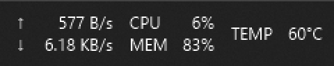

# Taskbar Monitor

A tiny Windows 11 widget that lives **inside the taskbar**, just left of the system tray, and shows live network speed, CPU, memory and temperature. No window, no tray icon, no installer: one small exe.



It is a from-scratch, taskbar-only rewrite of the idea behind [TrafficMonitor](https://github.com/zhongyang219/TrafficMonitor). No code was copied from that project.

## Features

- **Upload / Download speed** (B/s or bit/s, auto-scaled units, fixed-width values so nothing jitters)
- **CPU %** and **memory %**
- **TEMP**: the system thermal zone, no admin needed
- **GPU / DISK temperatures** (opt-in, runs as administrator)
- Transparent background, follows the Windows light/dark theme, per-monitor DPI aware
- Re-attaches by itself when `explorer.exe` restarts or the tray changes width
- Light on resources: about 0.3% of one core and ~10-20 MB RAM at the default 1 s refresh

## Requirements

- Windows 11, bottom taskbar on the main monitor
- [.NET 10 Desktop Runtime](https://dotnet.microsoft.com/download/dotnet/10.0) (x64)

## Build and run

```powershell
dotnet publish -c Release -o publish
.\publish\TaskbarMonitor.exe
```

Keep the files next to the exe together (`publish` also contains two small helper DLLs used by the optional sensors).

Quit with right-click > **Exit**. Starting a second copy does nothing (single instance).

## Menu (right-click the widget)

| Item | What it does |
|---|---|
| Upload / Download / CPU / Memory / Temperature | Show or hide each value (at least one stays visible) |
| Show speed in bits | Switch between B/s and bit/s |
| Font size | 10-16 px |
| Position | Nudge the widget left or right, or reset (useful to avoid the Widgets button) |
| Refresh rate | 0.5 / 1 / 2 / 5 seconds (0.5 s costs about twice the CPU) |
| GPU/disk temperatures | Restarts the app as administrator (UAC prompt) and adds GPU and DISK values |
| Start with Windows | Adds or removes a per-user startup entry (starts the normal, non-admin copy) |
| Exit | Closes the widget |

Settings are saved to `%APPDATA%\TaskbarMonitor\config.json`:

```json
{
  "ShowUp": true, "ShowDown": true, "ShowCpu": true, "ShowMemory": true, "ShowTemp": true,
  "AdminSensors": false, "RefreshMs": 1000, "Bits": false,
  "FontPx": 12, "OffsetX": 0, "TextColor": "auto"
}
```

`TextColor` is `"auto"` (white on dark theme, near-black on light) or a colour such as `"#FFAA00"`.

## Notes on the numbers

- **Network** sums every adapter that is up and has a default gateway. Windows also lists filter layers and WAN miniports that mirror the real adapter's counters, so those are ignored to avoid counting traffic several times. A VPN adapter that has its own gateway may double count.
- **TEMP** is the hottest ACPI thermal zone Windows reports. It is a board/package temperature, not a per-core reading, and is hidden on machines without a thermal zone.
- **GPU / DISK** use [LibreHardwareMonitor](https://github.com/LibreHardwareMonitor/LibreHardwareMonitor) and only work as administrator. Whether you get a value depends on the hardware (some integrated GPUs expose none). CPU and motherboard sensors are deliberately not used because they need a kernel driver.

## How it works

The widget is a layered child window of the taskbar (`Shell_TrayWnd`) drawn with per-pixel alpha and placed left of `TrayNotifyWnd`. Windows 11 paints the taskbar in a full-width XAML bridge window that is the topmost child, so the widget is kept at the top of the z-order. See [docs/superpowers/specs/2026-10-25-taskbar-only-design.md](docs/superpowers/specs/2026-10-25-taskbar-only-design.md) for the design, measurements and pitfalls.

| File | Role |
|---|---|
| `Program.cs` | Entry point, single-instance mutex, `--selftest` |
| `TaskbarWindow.cs` | Window, positioning, drawing, menu |
| `Stats.cs` | Network, CPU, memory, temperature sampling and formatting |
| `Sensors.cs` | Optional admin-only GPU/disk sensors |
| `Config.cs` | `config.json` and the startup entry |

## Development

```powershell
dotnet build -c Release
dotnet run -c Release -p:Selftest=true -- --selftest   # prints PASS
```

The self-check build writes to `bin\selftest` so its console exe never ends up in a publish. Win32 calls are generated at build time by [CsWin32](https://github.com/microsoft/CsWin32) (see `NativeMethods.txt`).

## Not verified / known limits

Tested on one machine (Windows 11, 100% scale, dark theme, one monitor). Not yet exercised: 125%/150% scaling, light theme, taskbar auto-hide, multiple monitors, the admin sensor mode with real GPU/disk hardware. Windows 10 and non-bottom taskbars are not supported.

## License

No license has been chosen yet, so all rights are reserved by default. Add a `LICENSE` file before others reuse the code.
